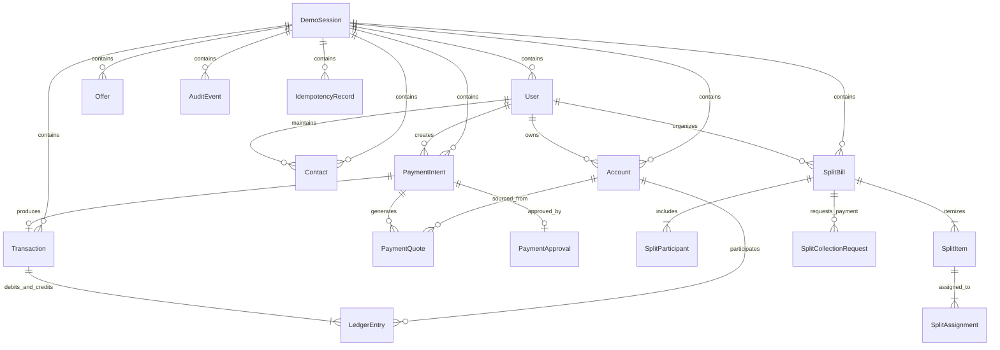

# Fintech Sandbox API - Domain Data Model

All database models are partitioned by `demo_session_id` to guarantee multi-tenant session isolation.

---

## 1. Entity-Relationship Diagram

---

## 2. Entity Details

### 2.1 DemoSession
- `id` (VARCHAR(36), PK): UUID.
- `display_name` (VARCHAR(100)): Scenario name or session label.
- `owner_id` (VARCHAR(50)): Creator identifier.
- `seed_scenario` (VARCHAR(50)): `scenario_a`, `scenario_b`, `scenario_c`.
- `seed_version` (VARCHAR(20)): Seed schema version.
- `status` (VARCHAR(20)): `ACTIVE`, `EXPIRED`, `RESETTING`.
- `created_at` (TIMESTAMP WITH TIME ZONE).
- `expires_at` (TIMESTAMP WITH TIME ZONE).

### 2.2 User
- `id` (VARCHAR(36), PK).
- `demo_session_id` (VARCHAR(36), FK, Indexed).
- `display_name` (VARCHAR(100)): e.g. "An (User)", "Nguyễn Minh", "Trần Minh", "Lan".
- `role` (VARCHAR(20)): `PRIMARY_USER`, `PARTICIPANT`.
- `phone_number` (VARCHAR(20), Nullable).
- `created_at` (TIMESTAMP WITH TIME ZONE).

### 2.3 Account
- `id` (VARCHAR(36), PK).
- `demo_session_id` (VARCHAR(36), FK, Indexed).
- `owner_user_id` (VARCHAR(36), FK, Indexed).
- `account_type` (VARCHAR(30)): `EWALLET`, `SIMULATED_BANK`, `SIMULATED_CARD`, `INTERNAL_SETTLEMENT`.
- `display_name` (VARCHAR(100)): e.g. "Ví MoMo Sandbox", "Vietcombank Sandbox", "MoMo Tech Card".
- `account_number` (VARCHAR(50)): Fictional account or card mask.
- `currency` (VARCHAR(5)): Always `VND`.
- `available_balance_vnd` (BIGINT): Current cash or available credit.
- `credit_limit_vnd` (BIGINT): Null for debit/wallet; explicit limit for simulated cards.
- `enabled` (BOOLEAN): Active or locked.
- `created_at`, `updated_at`.

### 2.4 Contact
- `id` (VARCHAR(36), PK).
- `demo_session_id` (VARCHAR(36), FK, Indexed).
- `owner_user_id` (VARCHAR(36), FK, Indexed).
- `display_name` (VARCHAR(100)): Contact name (e.g. "Nguyễn Minh").
- `alias` (VARCHAR(50), Nullable): Nickname or short search key (e.g. "Minh").
- `phone_number` (VARCHAR(20), Nullable).
- `recipient_account_id` (VARCHAR(36), FK): Points to internal simulated account.
- `bank_name` (VARCHAR(100), Nullable).
- `created_at`.

### 2.5 PaymentIntent
- `id` (VARCHAR(36), PK).
- `demo_session_id` (VARCHAR(36), FK, Indexed).
- `creator_user_id` (VARCHAR(36), FK).
- `recipient_account_id` (VARCHAR(36), FK).
- `amount_vnd` (BIGINT): Principal transfer amount.
- `currency` (VARCHAR(5)): `VND`.
- `description` (TEXT): Transfer reason or note.
- `merchant_id` (VARCHAR(50), Nullable).
- `status` (VARCHAR(30)): `DRAFT`, `QUOTED`, `AWAITING_APPROVAL`, `APPROVED`, `PROCESSING`, `SIMULATED_SUCCESS`, `FAILED`, `CANCELLED`, `EXPIRED`.
- `version` (INT): Incremented on any modification to invalidate stale approvals.
- `created_at`, `updated_at`, `expires_at`.

### 2.6 PaymentQuote
- `id` (VARCHAR(36), PK).
- `payment_intent_id` (VARCHAR(36), FK, Indexed).
- `source_account_id` (VARCHAR(36), FK).
- `amount_vnd` (BIGINT): Intent principal amount.
- `fee_vnd` (BIGINT): Payment fee.
- `immediate_discount_vnd` (BIGINT): Discount directly deducted from debit.
- `amount_debited_vnd` (BIGINT): `amount_vnd + fee_vnd - immediate_discount_vnd`.
- `estimated_reward_vnd` (BIGINT): Expected points or cashback credit.
- `effective_cost_vnd` (BIGINT): `amount_debited_vnd - estimated_reward_vnd`.
- `eligible` (BOOLEAN): Whether source has sufficient liquidity and passes rules.
- `eligibility_reason` (TEXT): Machine and human readable reason code.
- `applied_offer_ids` (JSONB): IDs of matched offers.
- `source_version` (INT): Version of source at quote generation time.
- `status` (VARCHAR(20)): `ACTIVE`, `USED`, `EXPIRED`.
- `expires_at` (TIMESTAMP WITH TIME ZONE).

### 2.7 PaymentApproval
- `id` (VARCHAR(36), PK).
- `payment_intent_id` (VARCHAR(36), FK, Unique).
- `approved_quote_id` (VARCHAR(36), FK).
- `actor_user_id` (VARCHAR(36), FK).
- `approved_intent_version` (INT): Must match current `PaymentIntent.version`.
- `approved_payment_snapshot` (JSONB): Immutable snapshot of `{amount_vnd, fee_vnd, discount_vnd, debited_vnd, recipient_id, source_id}`.
- `approved_at` (TIMESTAMP WITH TIME ZONE).

### 2.8 Transaction
- `id` (VARCHAR(36), PK).
- `demo_session_id` (VARCHAR(36), FK, Indexed).
- `payment_intent_id` (VARCHAR(36), FK, Unique, Nullable).
- `source_account_id` (VARCHAR(36), FK).
- `destination_account_id` (VARCHAR(36), FK).
- `amount_vnd` (BIGINT).
- `fee_vnd` (BIGINT).
- `status` (VARCHAR(20)): `SUCCESS`, `FAILED`.
- `idempotency_key` (VARCHAR(100), Nullable, Indexed).
- `created_at`, `completed_at`.

### 2.9 LedgerEntry
- `id` (VARCHAR(36), PK).
- `transaction_id` (VARCHAR(36), FK, Indexed).
- `account_id` (VARCHAR(36), FK, Indexed).
- `direction` (VARCHAR(10)): `DEBIT` or `CREDIT`.
- `amount_vnd` (BIGINT): Strictly positive integer.
- `created_at` (TIMESTAMP WITH TIME ZONE).

### 2.10 Offer
- `id` (VARCHAR(36), PK).
- `demo_session_id` (VARCHAR(36), FK, Indexed).
- `display_name` (VARCHAR(150)).
- `code` (VARCHAR(50)): Promo code or identifier.
- `eligible_source_types` (JSONB): e.g. `["EWALLET", "SIMULATED_BANK"]`.
- `eligible_merchant_ids` (JSONB): Null for universal or list of merchants.
- `minimum_amount_vnd` (BIGINT).
- `maximum_discount_vnd` (BIGINT).
- `reward_type` (VARCHAR(30)): `INSTANT_DISCOUNT` or `CASHBACK`.
- `reward_value_percent` (NUMERIC(5, 2), Nullable).
- `reward_value_flat_vnd` (BIGINT, Nullable).
- `starts_at`, `expires_at`.
- `usage_limit` (INT): Remaining redemptions.
- `active` (BOOLEAN).

### 2.11 SplitBill & Participants
- `SplitBill`: `id`, `demo_session_id`, `creator_user_id`, `payer_user_id`, `title`, `total_amount_vnd`, `tax_vnd`, `fee_vnd`, `discount_vnd`, `status` (`DRAFT`, `ACTIVE`, `SETTLED`), `created_at`.
- `SplitParticipant`: `id`, `split_bill_id`, `user_id`, `display_name`, `share_amount_vnd`, `paid_amount_vnd`, `status` (`PENDING`, `SETTLED`).
- `SplitItem`: `id`, `split_bill_id`, `name`, `unit_price_vnd`, `quantity`, `total_price_vnd`.
- `SplitAssignment`: `id`, `split_item_id`, `participant_id`, `weight` (Default 1 for equal share).
- `SplitCollectionRequest`: `id`, `split_bill_id`, `participant_id`, `requested_amount_vnd`, `collected_amount_vnd`, `status` (`UNPAID`, `PAID`, `CANCELLED`), `qr_payload`, `payment_link`, `created_at`, `updated_at`.

### 2.12 AuditEvent & IdempotencyRecord
- `AuditEvent`: `id`, `demo_session_id`, `actor_type` (`USER`, `AGENT`, `SYSTEM`), `actor_id`, `event_type`, `entity_type`, `entity_id`, `metadata` (JSONB), `created_at`.
- `IdempotencyRecord`: `id`, `demo_session_id`, `scope_key`, `idempotency_key`, `request_hash`, `status_code`, `response_payload` (JSONB), `created_at`, `expires_at`.
