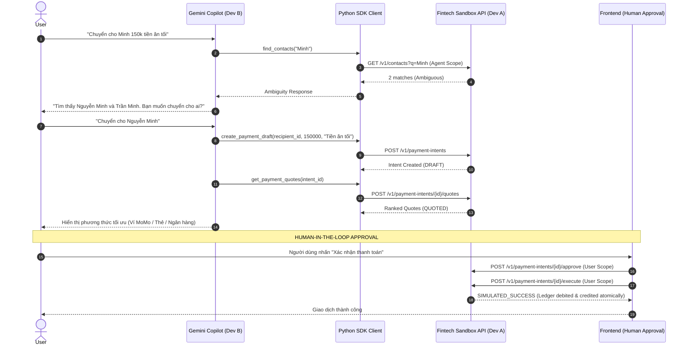

# Gemini Function Calling & AI Integration Guide

This guide is designed for **Developer B** (AI Copilot Engineer) to seamlessly integrate Google Gemini with the **Fintech Sandbox API**.

---

## 1. Architectural Integration Flow



---

## 2. Security Boundaries & Invariants

> [!IMPORTANT]
> **LLM TOOL RESTRICTION:**  
> The Gemini model must **NEVER** have access to approval or execution tools.  
> The LLM's role is strictly:
> 1. Entity extraction (recipient, amount, bill items).
> 2. Safe querying (contacts, balances, quotes).
> 3. Creating drafts (`DRAFT` state).
> 4. Explaining options to the user.
>
> Execution is gated behind explicit human approval in the application with a scoped `user` token.

---

## 3. Gemini Function Declarations (Tool Definitions)

Pass these declarations into your Gemini model setup (`tools=[...]` in `google-genai` SDK):

```json
[
  {
    "name": "find_contacts",
    "description": "Tìm kiếm người nhận trong danh bạ theo tên, biệt danh hoặc số điện thoại. Tự động kiểm tra tính nhập nhằng khi có nhiều người trùng tên.",
    "parameters": {
      "type": "OBJECT",
      "properties": {
        "query": {
          "type": "STRING",
          "description": "Tên người nhận, nickname hoặc số điện thoại, ví dụ: 'Minh', 'Lan', '0912345678'"
        }
      },
      "required": ["query"]
    }
  },
  {
    "name": "get_payment_sources",
    "description": "Lấy danh sách các nguồn tiền hiện có của người dùng (Ví MoMo, ngân hàng liên kết, thẻ tín dụng) kèm số dư khả dụng.",
    "parameters": {
      "type": "OBJECT",
      "properties": {}
    }
  },
  {
    "name": "create_payment_draft",
    "description": "Tạo bản nháp giao dịch chuyển tiền (DRAFT state). Chỉ tạo nháp, KHÔNG thực hiện thanh toán.",
    "parameters": {
      "type": "OBJECT",
      "properties": {
        "recipient_id": {
          "type": "STRING",
          "description": "ID tài khoản người nhận (lấy từ find_contacts)"
        },
        "amount_vnd": {
          "type": "INTEGER",
          "description": "Số tiền cần chuyển (VND, số nguyên dương)"
        },
        "note": {
          "type": "STRING",
          "description": "Lời nhắn hoặc nội dung chuyển tiền"
        }
      },
      "required": ["recipient_id", "amount_vnd", "note"]
    }
  },
  {
    "name": "get_payment_quotes",
    "description": "Tính toán và xếp hạng các phương thức thanh toán tối ưu cho một giao dịch nháp (so sánh phí, giảm giá tức thì, hoàn tiền cashback).",
    "parameters": {
      "type": "OBJECT",
      "properties": {
        "payment_intent_id": {
          "type": "STRING",
          "description": "ID của bản nháp giao dịch"
        }
      },
      "required": ["payment_intent_id"]
    }
  },
  {
    "name": "create_split_bill",
    "description": "Tạo yêu cầu chia hóa đơn nhóm chính xác theo từng món hoặc chia đều, kèm thuế, phí và giảm giá.",
    "parameters": {
      "type": "OBJECT",
      "properties": {
        "title": {
          "type": "STRING",
          "description": "Tên hóa đơn, ví dụ: 'Bữa trưa nhóm'"
        },
        "payer_name": {
          "type": "STRING",
          "description": "Tên người đã ứng tiền thanh toán toàn bộ hóa đơn"
        },
        "participants": {
          "type": "ARRAY",
          "description": "Danh sách người tham gia",
          "items": {
            "type": "OBJECT",
            "properties": {
              "display_name": {"type": "STRING"}
            },
            "required": ["display_name"]
          }
        },
        "items": {
          "type": "ARRAY",
          "description": "Danh sách các món trong hóa đơn",
          "items": {
            "type": "OBJECT",
            "properties": {
              "name": {"type": "STRING"},
              "unit_price_vnd": {"type": "INTEGER"},
              "quantity": {"type": "INTEGER"},
              "assigned_participant_names": {
                "type": "ARRAY",
                "items": {"type": "STRING"},
                "description": "Người ăn món này. Để trống nếu chia đều tất cả."
              }
            },
            "required": ["name", "unit_price_vnd"]
          }
        },
        "tax_vnd": {"type": "INTEGER", "description": "Tổng tiền thuế VAT (VND)"},
        "service_fee_vnd": {"type": "INTEGER", "description": "Tổng phí dịch vụ (VND)"},
        "discount_vnd": {"type": "INTEGER", "description": "Tổng tiền giảm giá hóa đơn (VND)"}
      },
      "required": ["title", "payer_name", "participants", "items"]
    }
  }
]
```

---

## 4. Complete Gemini Dispatcher Example (Python)

```python
import os
from google import genai
from google.genai import types
from sdk.python.fintech_sandbox_client import FintechSandboxClient

client = genai.Client(api_key=os.environ.get("GEMINI_API_KEY"))
sandbox_client = FintechSandboxClient(
    base_url="http://localhost:8000/v1",
    token=os.environ.get("SANDBOX_AGENT_TOKEN")
)

async def handle_tool_call(tool_name: str, args: dict):
    if tool_name == "find_contacts":
        res = await sandbox_client.find_contacts(args["query"])
        return res.model_dump(mode="json")
    elif tool_name == "get_payment_sources":
        res = await sandbox_client.get_payment_sources()
        return [s.model_dump(mode="json") for s in res]
    elif tool_name == "create_payment_draft":
        res = await sandbox_client.create_payment_draft(
            recipient_id=args["recipient_id"],
            amount_vnd=args["amount_vnd"],
            note=args["note"]
        )
        return res.model_dump(mode="json")
    elif tool_name == "get_payment_quotes":
        res = await sandbox_client.get_payment_quotes(args["payment_intent_id"])
        return [q.model_dump(mode="json") for q in res]
    elif tool_name == "create_split_bill":
        res = await sandbox_client.create_split_bill(args)
        return res.model_dump(mode="json")
    else:
        raise ValueError(f"Unknown tool: {tool_name}")
```

